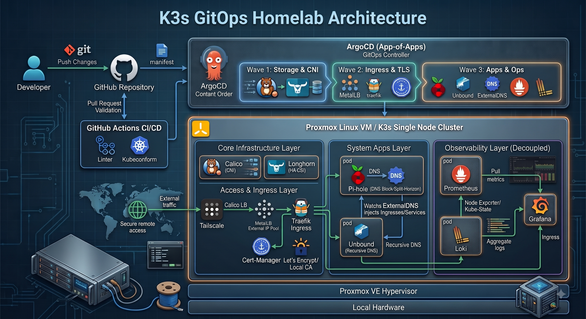

# 🚀 Enterprise GitOps Homelab


A GitOps-driven local Kubernetes homelab using **Terraform**, **K3s**, **Calico**, and **Argo CD**.

## 🏗️ Architecture



- **Infrastructure:** Proxmox VM provisioned with Terraform.
- **Cluster:** K3s.
- **CNI:** Calico, installed during bootstrap.
- **Pod CIDR:** `10.42.0.0/16`.
- **Service CIDR:** `10.43.0.0/16`.
- **CoreDNS Service IP:** `10.43.0.10`.
- **GitOps:** Argo CD App-of-Apps watching `main`.
- **Ingress:** Traefik.
- **Load balancing:** MetalLB.
- **Storage:** Longhorn.
- **Observability:** Prometheus, Loki, Grafana, and Alloy.
- **LAN DNS:** Pi-hole and Unbound.

See [docs/Service-Catalog.md](docs/Service-Catalog.md) for service URLs and [docs/Proxmox-Environment.md](docs/Proxmox-Environment.md) for the homelab inventory.

For the complete September 7, 2026 fresh-bootstrap investigation and runbook, see [docs/Bootstrap-Incident-2026-09-07.md](docs/Bootstrap-Incident-2026-09-07.md).

## ⚙️ GitOps Workflow

1. Make changes on `dev`.
2. GitHub Actions validates shell scripts, YAML, Helm rendering, and Kubernetes schemas.
3. Merge `dev` into `main`.
4. Argo CD reconciles the cluster from `main`.

### Manually sync Argo CD from GitHub Actions

The **Argo CD Sync** workflow runs only when you click **Run workflow**. It joins
Tailscale using the existing Terraform CI credentials, refreshes the selected
application, syncs its configured sources, and waits for `Synced` and `Healthy`.
The CLI version matches the bootstrap installer (`v3.5.1`).

Configure these under **Settings → Secrets and variables → Actions**:

| Kind | Name | Value |
| --- | --- | --- |
| Secret | `TS_OAUTH_CLIENT_ID` | Existing Tailscale OAuth client ID |
| Secret | `TS_OAUTH_SECRET` | Existing Tailscale OAuth secret authorized for `tag:ci` |
| Secret | `ARGOCD_AUTH_TOKEN` | Argo CD API token with application `get` and `sync` permissions for the intended applications |
| Secret | `ARGOCD_SERVER` | Tailnet-reachable Argo CD API address as `hostname:port`, without `https://` |

The bootstrap installs Argo CD with its default ClusterIP service; joining
Tailscale alone does not expose that service. First provide an HTTPS endpoint
through a tailnet proxy, ingress, or an exposed service reachable through your
Tailscale subnet router. Allow `tag:ci` to reach that endpoint in the tailnet
policy. The workflow accepts advertised subnet routes; a `*.homelab.local` name
also needs DNS resolution on the runner. Use a tailnet DNS name or routed IP
if your LAN DNS is unavailable.

Create a dedicated Argo CD API account/token rather than storing an admin
password. Its RBAC policy needs `applications, get` and `applications, sync`
for each target (for example, `default/<application>`). See the
[Argo CD local account and RBAC setup](https://argo-cd.readthedocs.io/en/stable/operator-manual/user-management/).
Store the token directly as `ARGOCD_AUTH_TOKEN`; the workflow uses token
authentication without an interactive login.

After merging this workflow into `main`, open **Actions → Argo CD Sync → Run
workflow**, select **main**, enter the target application name, and
run it. `root-app` updates the child Application definitions; it does not
recursively force-sync or wait for every child's workloads. Run the workflow
for the child application when you need to force its deployment. Existing
automatic reconciliation remains enabled for the root and child applications.

The workflow uses each application's configured target revision (`main` for
this repository's manifests, pinned chart versions for Helm applications).
It does not deploy the branch selected in the Actions UI; non-`main` runs are
skipped. Enable **prune** to request deletion of obsolete resources, or
**insecure** only when your private Argo CD endpoint uses a self-signed
certificate. Both default to false. Existing automated prune policies still
apply independently. Cluster sync runs are serialized and have bounded waits;
a failed or timed-out run does not roll back or cancel a server-side sync.

Calico is bootstrap-owned because Argo CD requires a working CNI before it can operate.

## ⚠️ Required Calico Setting for the Single-Node K3s Topology

This repository currently deploys K3s as a **single-node cluster**. For this topology, Calico **must keep overlay encapsulation disabled**:

```yaml
spec:
  calicoNetwork:
    containerIPForwarding: Enabled
    ipPools:
      - cidr: 10.42.0.0/16
        encapsulation: None
        natOutgoing: Enabled
```

Do **not** change this single-node deployment back to `VXLANCrossSubnet` or another VXLAN mode without revalidating the network dataplane.

During the September 2026 bootstrap investigation, Calico v3.32.1 with VXLAN enabled installed a live raw-table rule equivalent to:

```text
-p udp -j NOTRACK
```

The rule matched all UDP traffic instead of only VXLAN UDP/4789. Because kube-proxy was running in iptables mode, UDP Kubernetes Service NAT depended on conntrack. The blanket `NOTRACK` rule caused UDP Service traffic such as CoreDNS `10.43.0.10:53` to bypass normal conntrack/NAT handling.

Observed behavior:

- Pod-to-pod routing worked.
- TCP ClusterIP routing worked.
- Direct DNS to the CoreDNS pod IP worked.
- TCP to the CoreDNS ClusterIP worked.
- UDP to the CoreDNS ClusterIP failed.
- External UDP DNS from pods failed.

Changing the Calico pool to `encapsulation: None`, reconciling the operator, and restarting `calico-node` removed the blanket UDP `NOTRACK` rule. The cluster network acceptance test then passed all pod routing, Service, internal DNS, and external DNS checks.

For a future **multi-node** deployment, do not automatically reuse this assumption. Re-evaluate whether encapsulation is required for the node/subnet topology and validate the generated Calico and kube-proxy rules before enabling VXLAN.

See [docs/Troubleshooting.md](docs/Troubleshooting.md) for the troubleshooting summary and [docs/Bootstrap-Incident-2026-09-07.md](docs/Bootstrap-Incident-2026-09-07.md) for the complete incident record.

## 🚀 Fresh Bootstrap

The normal deployment flow starts by cloning this repository onto the new Ubuntu VM.

```bash
git clone https://github.com/Jeysibn/homelab-gitops.git
cd homelab-gitops
bash bootstrap.sh
```

**Do not run the bootstrap with `sudo`.** Run it as your normal Ubuntu user. The scripts call `sudo` only for the host operations that require root privileges and create kubeconfig for the user who launched the bootstrap.

`bootstrap.sh` automatically determines the cloned repository directory from its own location, then runs:

```text
bootstrap.sh
├── kubernetes/bootstrap/install-k3s.sh
│   ├── configure host networking
│   ├── install K3s
│   ├── install Calico
│   └── verify cluster networking
└── kubernetes/bootstrap/install-argocd.sh
    ├── install Argo CD
    └── apply root-app.yaml
```

You do not need to `chmod +x` the scripts when using `bash bootstrap.sh`.

### Run stages separately

K3s and Calico only:

```bash
bash kubernetes/bootstrap/install-k3s.sh
```

Argo CD only:

```bash
bash kubernetes/bootstrap/install-argocd.sh
```

The scripts resolve their manifest and helper paths from the directory where the scripts themselves are stored, so they do not depend on your current working directory.

### Normal-user kubeconfig requirement

The Argo CD installer intentionally refuses root execution. If `sudo kubectl` works but `bash kubernetes/bootstrap/install-argocd.sh` reports that the Kubernetes API is unreachable, refresh the normal user's kubeconfig:

```bash
mkdir -p "$HOME/.kube"
sudo install -m 600 -o "$(id -u)" -g "$(id -g)" \
  /etc/rancher/k3s/k3s.yaml "$HOME/.kube/config"
export KUBECONFIG="$HOME/.kube/config"
```

Then rerun the Argo CD stage without `sudo`.

## ✅ Bootstrap Safety Checks

The K3s bootstrap keeps only the checks required for a predictable fresh installation:

- Calico CIDR must match the K3s pod CIDR.
- UFW/firewalld must not silently block cluster networking.
- K3s must use a real upstream resolver instead of a loopback DNS stub.
- Calico must become ready.
- The node and CoreDNS must become ready.
- The cluster network acceptance test must pass before Argo CD is installed.

The separate acceptance test verifies pod routing, Service ClusterIP routing, CoreDNS, Kubernetes service discovery, and external GitHub DNS:

```bash
sudo bash kubernetes/bootstrap/verify-cluster-network.sh
```

Recovery logic is intentionally kept outside the normal fresh bootstrap. For an old cluster with stale Calico IPAM state, inspect it separately with:

```bash
bash kubernetes/bootstrap/recover-calico-ipam.sh --plan
```

## 🔎 Verify the Cluster

After bootstrap:

```bash
sudo kubectl get nodes
sudo kubectl get pods -A -o wide
sudo kubectl get applications -n argocd
sudo kubectl get svc -A | grep LoadBalancer
```

The desired root Argo CD state after convergence is:

```text
root-app   Synced   Healthy
```

A temporary `root-app Unknown` immediately after Argo CD startup can occur if the application-controller reconciles before repo-server or Redis is fully reachable. Inspect the Application conditions and Argo CD component logs before treating this as another cluster-network failure. Once the components are healthy, a hard refresh can force a new comparison.

Argo CD's root application points to `main`, so GitOps-managed services are reconciled from the production branch.

## 🌐 Local Routing

Traefik is the main HTTP/HTTPS entrypoint at `192.168.86.200`. Pi-hole provides LAN DNS at `192.168.86.201` and resolves `*.homelab.local` hostnames to Traefik.

| Service | Hostname |
| --- | --- |
| Grafana | `grafana.homelab.local` |
| Pi-hole | `pihole.homelab.local` |
| Longhorn | `longhorn.homelab.local` |
| Prometheus | `prometheus.homelab.local` |

## 🔐 Secrets

Some application credentials are still placeholders. A future improvement is to manage them with SOPS, Sealed Secrets, or External Secrets Operator.
