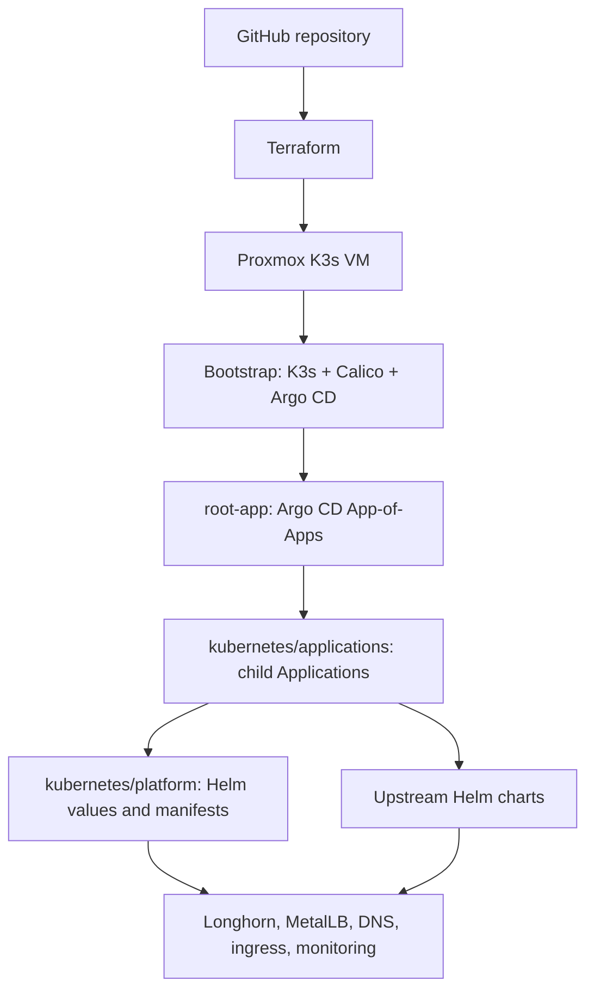

# Homelab GitOps

This repository provisions a Proxmox VM with Terraform, bootstraps a single-node
K3s cluster, and uses Argo CD to deploy the services running on it.

## Architecture



Terraform provisions the VM and related Proxmox resources. Bootstrap installs
K3s, Calico, and Argo CD; Calico stays outside Argo CD because the cluster
network must work before GitOps can run. Argo CD owns the platform services.
Helm continues to install third-party charts, with chart versions pinned in
each Argo CD Application.

The single K3s node uses pod CIDR `10.42.0.0/16`, service CIDR
`10.43.0.0/16`, and CoreDNS service IP `10.43.0.10`. Calico's current
single-node configuration keeps encapsulation disabled. See
[the bootstrap incident record](docs/Bootstrap-Incident-2026-09-07.md) before
changing those networking settings.

## Repository map

```text
terraform/                         Proxmox VM infrastructure
kubernetes/bootstrap/              K3s, Calico, and Argo CD initialization
kubernetes/applications/           One explicit Argo CD Application per service
kubernetes/platform/               Helm values and raw service manifests
docs/                               Architecture, service catalog, incidents
bootstrap.sh                        Fresh-cluster entry point
```

The existing root Application still points to `kubernetes/argocd-apps` during
the migration. The explicit files under `kubernetes/applications/` and copied
configuration under `kubernetes/platform/` are prepared for a reviewed cutover.
The old registry and source paths remain available for rollback until that
cutover is approved and verified. See
[the migration and cutover runbook](docs/GitOps-Structure-Migration.md).

## How GitOps synchronization works

`root-app` tracks `main` and reads the child Application definitions. Each
child Application tracks either a pinned upstream Helm chart plus a Git values
file, or a directory of repository-owned Kubernetes manifests. Automated sync,
pruning, and self-healing are enabled on the existing root and child apps.

Sync-wave annotations order child Application resources in the root sync. They
do not by themselves prove that each child workload is healthy before the next
wave starts. This Argo CD installation has no custom Application health check;
use the live child health and sync status to confirm readiness. Do not infer
workload health from the root sync alone.

## Making application changes

### Add an application

1. Add one file under `kubernetes/applications/` with a unique name in the
   `argocd` namespace, project `default`, destination namespace, and sync policy.
2. For a Helm chart, pin its chart version and use two sources: the upstream
   chart and this Git repository with `ref: values`. Point `helm.valueFiles`
   at `$values/kubernetes/platform/.../values.yaml`.
3. Put service settings under `kubernetes/platform/`. Put plain manifests in a
   service-specific `manifests/` directory and set the Application `path` to it.
4. Preserve the repository's automated prune/self-heal policy and choose a
   sync wave only when there is a real ordering reason. Review the Application
   and its deletion finalizer carefully; deleting an Application can delete its
   managed resources.
5. Open a pull request and review the Kubernetes CI results before merging.

During the current migration, new definitions are not deployed until the
approved root cutover. Keep `root-app` on its current path until then.

### Upgrade a Helm chart

Change only `spec.sources[0].targetRevision` in that service's Application
file. Review the chart's upgrade notes and rendered changes, then inspect the
Argo CD diff and health after the approved deployment. Keep the values file
unchanged unless the chart upgrade requires a separate configuration change.

### Change application configuration

Edit the corresponding values file under `kubernetes/platform/`, or the raw
manifest under that service's `manifests/` directory. Keep persistent volume
claims and storage requests unchanged unless a separately reviewed data
migration is planned. Commit configuration and chart-version changes
separately when possible so each diff is easy to understand.

## Validation and troubleshooting

The Kubernetes workflow checks shell syntax and YAML, renders the legacy
registry while it remains the live source, and validates Kubernetes
manifests. The Terraform workflow runs format, validation, lint, and plan.
**It also automatically runs `terraform apply -auto-approve` on pushes to
`main` that change `terraform/**`.** Review that infrastructure risk before
merging Terraform changes; this refactor does not alter that behavior.

The separate **Argo CD Sync** workflow is manual (`workflow_dispatch`). It
refreshes and syncs one named Application, then waits for that Application to
be Synced and Healthy. `root-app` refreshes child Application definitions; it
does not wait for every child workload. The workflow requires the repository
secrets `ARGOCD_SERVER`, `ARGOCD_AUTH_TOKEN`, `TS_OAUTH_CLIENT_ID`, and
`TS_OAUTH_SECRET`, plus a tailnet route to the Argo CD endpoint. Use the
workflow only after reviewing the target Application and its diff.

To inspect GitOps state from a machine with cluster access:

```bash
sudo kubectl get applications -n argocd
sudo kubectl describe application <name> -n argocd
sudo kubectl get pods,deployments,statefulsets -A
```

For an OutOfSync app, inspect its Argo CD diff and conditions first. Identify
the specific resource that differs before syncing or changing configuration.
An OutOfSync persistent volume claim may indicate a storage-size mismatch;
Kubernetes does not allow shrinking a bound claim by editing its request.
Never delete a claim or its namespace to clear an Argo CD diff. See
[Troubleshooting](docs/Troubleshooting.md) and the
[Longhorn incident record](docs/Longhorn-Multipath-Incident-2026-09-08.md).

After an approved change, check that the root and affected child Applications
are Synced and Healthy, workloads are ready, LoadBalancer services have their
expected addresses, and persistent volume claims remain Bound:

```bash
sudo kubectl get applications -n argocd
sudo kubectl get pods,svc -A
sudo kubectl get pvc -A
```

For initial installation on a new VM, run `bash bootstrap.sh` as the normal
Ubuntu user. Do not run the bootstrap as root. Existing-cluster bootstrap
scripts are not part of the GitOps structure migration.

## Secrets

This is a public repository. Do not commit passwords, tokens, private keys,
or rendered Kubernetes Secrets. Store runtime credentials using an approved
secret-management method outside plain Git values; keep examples clearly
marked as placeholders. If a real credential was committed, rotate it and
remove it from Git history as a separate security response.

## Further reading

- [Service catalog](docs/Service-Catalog.md)
- [Proxmox environment](docs/Proxmox-Environment.md)
- [Troubleshooting](docs/Troubleshooting.md)
- [Bootstrap incident](docs/Bootstrap-Incident-2026-09-07.md)
- [Longhorn multipath incident](docs/Longhorn-Multipath-Incident-2026-09-08.md)
- [GitOps structure migration and cutover](docs/GitOps-Structure-Migration.md)
